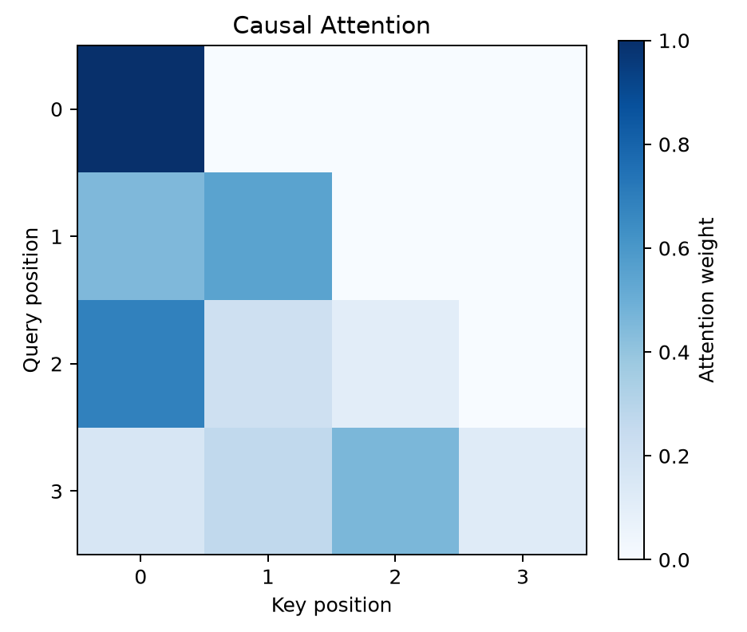

# 第七课 · 文本表示、注意力与解码评估

[返回项目首页](../README.md)

本课练习包括文本分词与 token embedding、缩放点积注意力与因果掩码，以及贪心解码、束搜索、Top-p 采样和 corpus BLEU。三项练习的代码均已补全，Notebook 中保留了示例运行输出。

## 练习入口

| 练习 | 内容 | 入口 |
| :--- | :--- | :--- |
| Practice 1 | 实现 token ID 编码、embedding 查表和余弦相似度 | [Notebook](practice1/Practice%201%20From%20Text%20to%20Token%20Embeddings.ipynb) |
| Practice 2 | 计算缩放点积分数、应用因果掩码、组合 value 并保存热图 | [Notebook](practice2/Practice%202%20Causal%20Attention%20by%20Hand.ipynb) · [结果图](practice2/attention_23.png) |
| Practice 3 | 实现贪心解码、束搜索和 corpus BLEU，运行给定的 Top-p 示例 | [Notebook](practice3/Practice%203%20Decoding%20and%20Evaluation.ipynb) |

每份 Notebook 的 Q1 为本科生和研究生必做；Q2–Q3 为研究生必做、本科生选做。填写时保留题目要求的代码行数，并按标记区分需要编辑、阅读和直接运行的部分。

## 运行方式

先按[项目首页](../README.md#快速开始)安装依赖，选择对应的 Python 内核，按题目要求将 `SID` 设置为学号末两位，从上到下运行 Notebook。当前三份 Notebook 中的 `SID` 均为 `23`。

运行时以对应的 `practice` 目录为工作目录。例如，在项目根目录运行：

```bash
cd Lesson7/practice2
jupyter lab
```

Practice 3 的 BLEU 示例会使用前面生成的 `greedy_ids` 和 `beam_ids`，因此应依次运行解码与评估单元格。

## 数据准备

本课主要使用 PyTorch 和 Matplotlib，三个练习均使用 Notebook 内构造的数据，无需下载外部数据集或预训练权重。

- Practice 1 使用三段文本建立本地词表，随机生成 embedding 矩阵，并用人工设定的向量演示余弦相似度；无需训练。
- Practice 2 使用固定随机种子生成的小型 `Q`、`K`、`V` 张量，分步计算因果注意力。
- Practice 3 使用固定的下一 token 分数和分词后的参考译文。这个教学示例中，不同前缀共享同一组分数；Top-p 示例使用固定随机种子 `2026`。

## 输出与路径

Practice 1、3 的结果直接打印在 Notebook 中。Practice 2 将热图保存为 `attention_<SID>.png`，当前已有 [attention_23.png](practice2/attention_23.png)。

图片保存到当前工作目录。在编辑器中可运行 `import os; print(os.getcwd())`，确认工作目录为对应练习目录。

<p align="center">
  
  <br>
  <sub>Practice 2 · 每个 query 只关注当前位置及更早的 key</sub>
</p>

## 当前运行结果

以下数值来自 Notebook 中保存的示例输出。

| 练习 | 观察项 | 结果 |
| :--- | :--- | :--- |
| Practice 1 | 英文示例的 token ID 与 embedding 形状 | `[7, 9, 11, 8, 3]`，形状为 `(5, 4)` |
| Practice 1 | 人工给定向量的余弦相似度 | `motel / hotel` 约为 `0.9986`；`motel / banana` 为 `0.0000` |
| Practice 2 | 注意力权重与未来位置 | 每行权重和为 `1`，未来位置权重总和为 `0.0` |
| Practice 2 | context 与权重形状 | 分别为 `(4, 2)`、`(4, 4)` |
| Practice 3 | 完全匹配与修改译文的 corpus BLEU | 分别为 `1.0`、`0.4762` |
| Practice 3 | 贪心和束搜索结果对第一句参考译文的 BLEU | 均为 `1.0` |

Practice 3 的解码输出如下，返回的 token ID 均不包含 EOS：

| 方法 | Token ID | 文本 |
| :--- | :--- | :--- |
| 贪心解码 | `[3, 4, 5, 6]` | `I like this course` |
| 束搜索，`beam_width=2` | `[3, 4, 5, 6]` | `I like this course` |
| Top-p，`p=0.9`、`temperature=1.2` | `[3, 8, 9, 10]` | `I enjoy deep learning` |

BLEU 按语料累计裁剪后的 n-gram 匹配数，默认计算 1–4 gram，并加入长度惩罚，不使用平滑。按本练习约定，没有候选 n-gram 的阶数将 precision 设为 `1.0`；候选总长度为零或任一所需 precision 为零时返回 `0.0`。

这些结果用于观察计算流程：Practice 1 的相似度示例使用人工设定的向量，Practice 3 使用固定分数和三句教学译文，数值不代表真实语言模型的翻译性能。
