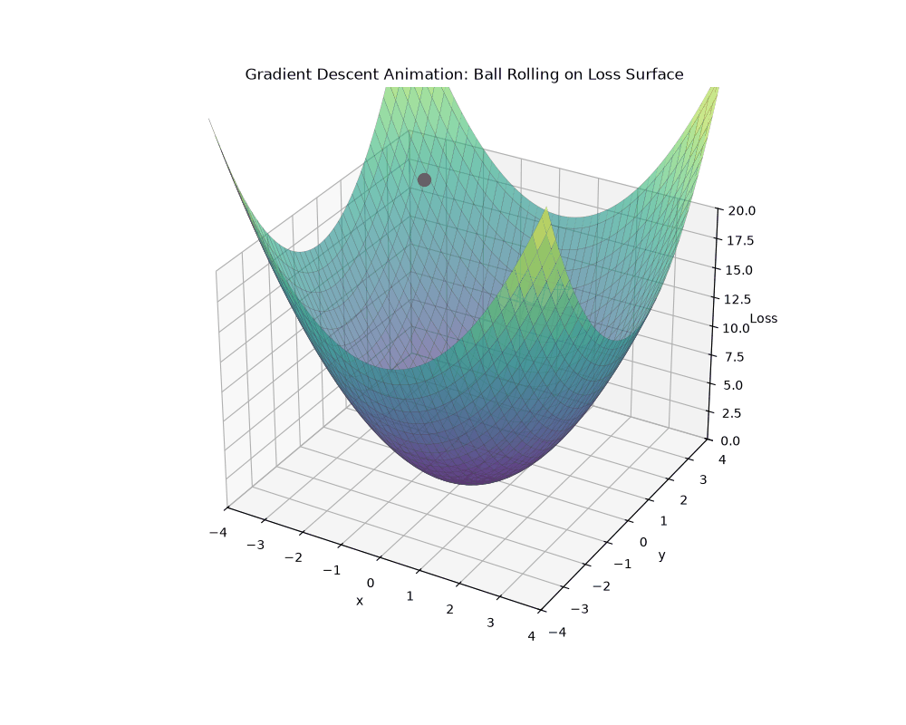

<div align="center">

# OUC Deep Learning

深度学习课程的学习笔记、实践代码与实验记录


[课程内容](#课程内容) · [快速开始](#快速开始) · [数据准备](#数据准备)

</div>

本仓库按课程章节整理 Notebook、示例图片和实验结果，随学习进度持续更新。目前收录第一课和第二课的练习，后续课程会继续按章节扩展。

## 课程内容

### 第一课 · 基础实践

| 练习 | 主题 | 内容 | 入口 |
| :--- | :--- | :--- | :---: |
| Practice 1 | Notebook 入门 | 函数、随机数与基础绘图 | [Notebook](first_class/practice1/Practice1.ipynb) |
| Practice 2 | 数据拟合 | 对比直线、多项式与小型神经网络的拟合结果和损失 | [Notebook](first_class/practice2/Practice2.ipynb) |
| Practice 3 | 数据加载 | MNIST、Dataset、DataLoader 与批次 | [Notebook](first_class/practice3/Practice3.ipynb) |
| Practice 4 | 图像分类 | 使用预训练 ResNet18 进行推理，查看 Top-5 预测 | [Notebook](first_class/practice4/练习4.ipynb) |

### 第二课 · 神经网络训练基础

| 练习 | 主题 | 内容 | 入口 |
| :--- | :--- | :--- | :---: |
| Practice 1 | 前向传播 | 用 NumPy 实现两层全连接网络的前向计算 | [Notebook](second_class/practice1/Practice1.ipynb) |
| Practice 2 | 损失函数 | 实现二元交叉熵与平均代价，并生成演示图 | [Notebook](second_class/practice2/Practice2.ipynb) · [结果图](second_class/practice2/bce_demo.png) |
| Practice 3 | 梯度与反向传播 | 实现数值梯度与计算图反向传播，生成梯度下降动画 | [Notebook](second_class/practice3/Practice3.ipynb) · [动画](second_class/practice3/gradient_descent.gif) |

<p align="center">
  
  <br>
  <sub>第二课 Practice 3 · 梯度下降轨迹</sub>
</p>

## 快速开始

### 1. 获取项目

```bash
git clone https://github.com/yuanfendtiankong/Ouc_DeepLearning.git
cd Ouc_DeepLearning
```

### 2. 安装依赖

在你使用的 Python 环境中安装 Jupyter Notebook 和通用依赖：

```bash
python -m pip install notebook numpy matplotlib pillow
```

另外，根据操作系统及 CPU/CUDA 环境，按照 [PyTorch 官方安装指南](https://docs.pytorch.org/get-started/locally/)安装兼容的 `torch` 和 `torchvision`。

### 3. 打开 Notebook

```bash
jupyter notebook
```

打开对应练习的 `.ipynb` 文件，选择已安装依赖的 Python 内核，按 Notebook 中的说明运行。第一课 Practice 3 需要先完成下方的 MNIST 数据准备。

## 数据准备

第二课的三个练习使用 Notebook 内构造的数据，当前无需额外下载数据集。

### MNIST · 第一课 Practice 3

[数据集官网](https://yann.lecun.org/exdb/mnist/index.html) · [TorchVision 文档](https://docs.pytorch.org/vision/stable/generated/torchvision.datasets.MNIST.html)

**自动下载（推荐）**

在项目根目录运行一次，TorchVision 会下载并解压所需文件：

```bash
python -c "from torchvision.datasets import MNIST; MNIST(root='first_class/practice3/data', download=True)"
```

数据将保存在 `first_class/practice3/data/MNIST/raw/`。该数据目录已加入 `.gitignore`，克隆仓库后需自行下载。

> 第一课 Practice 3 使用 `root="./data"`，运行时应以 `first_class/practice3/` 为工作目录。完成上述下载后，可保留 Notebook 中的 `download=False`。

<details>
<summary>手动下载：文件链接与目录结构</summary>

以下是 TorchVision 使用的 MNIST 镜像文件：

| 内容 | 下载链接 |
| :--- | :--- |
| 训练图像 | [train-images-idx3-ubyte.gz](https://ossci-datasets.s3.amazonaws.com/mnist/train-images-idx3-ubyte.gz) |
| 训练标签 | [train-labels-idx1-ubyte.gz](https://ossci-datasets.s3.amazonaws.com/mnist/train-labels-idx1-ubyte.gz) |
| 测试图像 | [t10k-images-idx3-ubyte.gz](https://ossci-datasets.s3.amazonaws.com/mnist/t10k-images-idx3-ubyte.gz) |
| 测试标签 | [t10k-labels-idx1-ubyte.gz](https://ossci-datasets.s3.amazonaws.com/mnist/t10k-labels-idx1-ubyte.gz) |

下载后解压四个 `.gz` 文件，确保以下不带 `.gz` 后缀的文件存在：

```text
first_class/practice3/data/MNIST/raw/
├── train-images-idx3-ubyte
├── train-labels-idx1-ubyte
├── t10k-images-idx3-ubyte
└── t10k-labels-idx1-ubyte
```

</details>

### 图片输入 · 第一课 Practice 4

Notebook 默认读取同目录下的 `my_photo.jpg`。使用其他图片时，将图片放入练习目录，并修改 `IMG_PATH` 指向对应文件。
